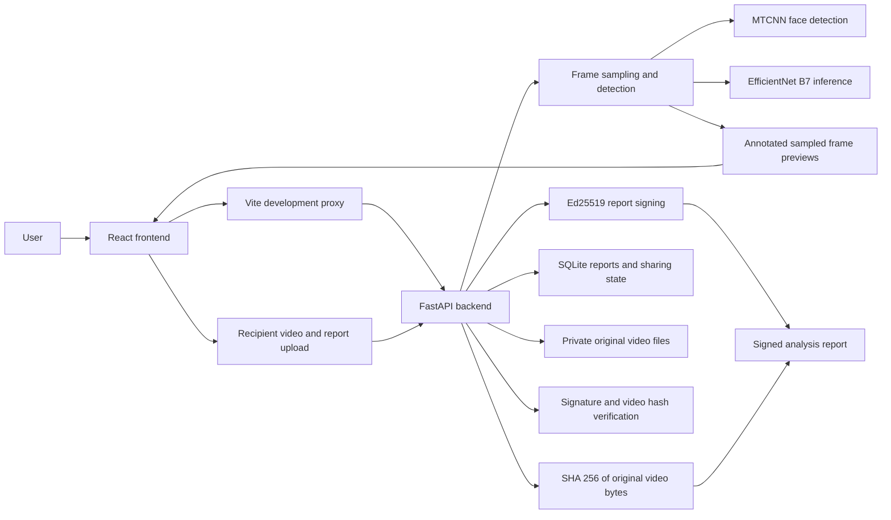

# Video Deepfake Screening and Verification

## Project overview

This project provides a local web app for screening videos for possible facial manipulation and checking the integrity of signed analysis reports. It addresses two related but separate needs: an AI model can flag visual patterns for review, while cryptography can show whether a report was signed by this service and whether it matches the exact video bytes being checked.

The AI result is an estimate, not proof that a video is genuine or manipulated. Scores are not calibrated probabilities. No labeled evaluation dataset or measured detection-performance results are included.

## How to use the app

1. Open the web app and upload a video for analysis.
2. Review the assessment, score, frame and face counts, and annotated previews of the exact sampled frames. Green boxes mark scored faces; amber boxes mark faces excluded from scoring.
3. Download the signed report. Sharing is enabled only when the backend's eligibility policy allows it.
4. A recipient can use the share link or submit the video and signed report to check the signature and exact-file hash independently.
5. Optionally request an AI-generated text summary of the report metrics. This is not visual feature attribution. Only report metrics are sent to the configured explanation service; video bytes and frames are not.

Changing video bytes, including recompressing the file, causes its hash comparison to fail against the original signed report.

## Architecture



In development, the Vite server on port `5173` proxies API requests to FastAPI on port `8000`. The backend stores reports and sharing state in SQLite and keeps uploaded originals in its runtime directory. Frame previews are generated from the detector's decoded samples, returned with the analysis response, and excluded from the signed report.

## Technical specifications

- **Detection:** MTCNN face detection and a pinned EfficientNet-B7 TorchScript checkpoint, run on CPU. The pipeline samples up to 12 frames by default and scores eligible detected faces.
- **Aggregation:** the highest eligible face score contributes to the video result. Default provisional thresholds are `0.20` for low detected risk and `0.80` for suspicious; insufficient frame coverage or rejected faces can leave the result inconclusive. Settings can be adjusted in `backend/config.json`.
- **Limits:** defaults allow videos up to 100 MB and 120 seconds. The backend also limits decoded frame dimensions, concurrent analysis, and processing time.
- **Reports:** versioned JSON envelopes contain a canonical signed report, including the SHA-256 digest and byte length of the original video.
- **Explanation:** optional AI text summary of assessment and coverage metrics. It does not inspect video frames or provide feature attribution.

### HTTP API

Mutating private API calls require the browser session cookie and `x-csrf-token` returned by `GET /api/session`. Upload endpoints use multipart form data.

| Method and path | Purpose |
| --- | --- |
| `GET /api/session` | Establish a browser session and return a CSRF token. |
| `GET /api/status` | Return model availability, configured limits, and explanation availability. |
| `POST /api/analyze` | Analyze multipart field `video`; returns the report, signed envelope, and annotated frame previews. |
| `GET /api/reports` | List reports owned by the current browser session. |
| `GET /api/reports/{identifier}` | Retrieve an owned report and its signed envelope. |
| `POST /api/reports/{identifier}/explanation` | Request an optional AI narrative for an owned report. |
| `POST /api/reports/{identifier}/share` | Create an eligible share link for an owned report. |
| `POST /api/reports/{identifier}/revoke` | Revoke active share links for an owned report. |
| `POST /api/verify` | Verify multipart fields `video` and `report`; returns signature and hash outcomes separately. |
| `GET /s/{token}` | Open an active recipient share page. |
| `GET /s/{token}/video` | Retrieve the video through an active share. |
| `GET /s/{token}/report` | Retrieve the signed report through an active share. |

## Security and trust boundaries

- **Cryptographic integrity:** SHA-256 is computed over the original uploaded bytes. Ed25519 signs the canonical report payload. Verification checks that signature against the backend's trusted public-key registry and independently hashes the received video bytes.
- **Separate claims:** a valid signature identifies a report signed by the service; a matching hash associates it with those exact bytes. Neither proves the depicted event is real.
- **Key handling:** the Ed25519 private key stays in backend runtime storage with restrictive file permissions. It is not sent to the browser. The optional explanation API key belongs in the ignored root `.env` file, never in frontend code or commits.
- **Private operations:** browser-session ownership and CSRF checks protect report, analysis, and sharing routes. The backend enforces sharing eligibility and checks active share state on recipient requests; revocation blocks future access.
- **Upload protections:** request sizes, video duration and decoded dimensions, analysis concurrency, and processing time are bounded. Uploaded videos use server-generated filenames and remain in backend runtime storage.
- **AI explanation privacy:** the current explanation integration sends report metrics and assessment text to its configured cloud endpoint, not the video or frame previews. The returned text is a narrative summary and can be inaccurate.

This is a local prototype, not a production hosting configuration. No independent security audit or measured detector accuracy is claimed.

## Repository structure

```text
.
├── backend/
│   ├── app/          # API, detection, signing, verification, sharing, persistence
│   ├── datasets/     # Dataset acquisition and evaluation notes
│   ├── docs/         # Architecture, security, evaluation, demo guides
│   ├── models/       # Downloaded, checksum-verified model assets
│   ├── scripts/      # Model asset setup scripts
│   └── tests/        # Backend tests
└── frontend/
    ├── src/          # React interface and styles
    └── package.json  # Frontend scripts and dependencies
```

## Developer setup

Run the backend commands from `backend/` in PowerShell. The UV environment and model assets are prepared once:

```powershell
uv venv
uv pip install --python .venv\Scripts\python.exe -r requirements.txt
.\.venv\Scripts\python.exe scripts\download_model.py
.\.venv\Scripts\python.exe scripts\setup_faces.py
```

The two scripts download the pinned detector checkpoint and MTCNN weights and verify their checksums. Start the backend in one terminal:

```powershell
.\.venv\Scripts\python.exe -m uvicorn app.asgi:app --reload --host 127.0.0.1 --port 8000 --workers 1
```

In a second terminal, run the frontend from `frontend/`:

```powershell
npm ci
npm run dev
```

Open <http://127.0.0.1:5173/>. Keep both servers running. To enable the optional text summary, place the provider key in a root `.env` file; for the current Ollama cloud integration:

```dotenv
OLLAMA_API_KEY=your-api-key
OLLAMA_MODEL=gemma4:31b
```

The model setting is optional. Restart the backend after editing `.env`; `.env` is ignored by Git. Run backend tests from `backend/` with:

```powershell
.\.venv\Scripts\python.exe -m pytest -q
```
