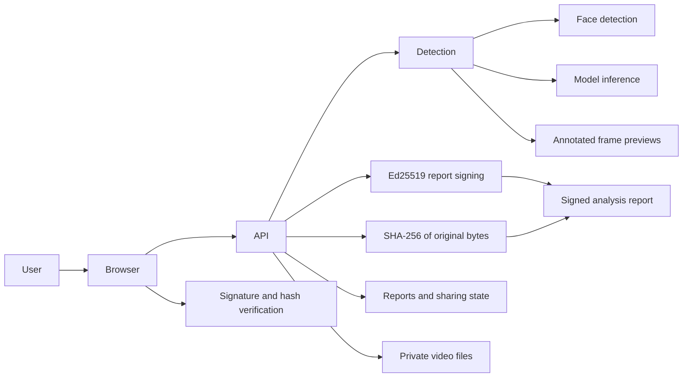

# Video Deepfake Screening and Verification

## Project overview

This project provides a local web app for screening videos for possible facial manipulation and checking the integrity of signed analysis reports. It addresses two related but separate needs: an AI model can flag visual patterns for review, while cryptography can show whether a report was signed by this service and whether it matches the exact video bytes being checked.

The AI result is an estimate, not proof that a video is genuine or manipulated. Scores are not calibrated probabilities. The pipeline is benchmarked on a held-out split of the **Celeb-DF v2** dataset (590 original YouTube videos and 5,639 DeepFake videos; 9.5 GB total); raw dataset files are not bundled in this repository and must be acquired separately.

## How to use the app

1. Open the web app and upload a video for analysis.
2. Review the assessment, score, frame and face counts, and annotated previews of the exact sampled frames. Green boxes mark scored faces; amber boxes mark faces excluded from scoring.
3. Download the signed report. Sharing is enabled only when the backend's eligibility policy allows it.
4. A recipient can use the share link or submit the video and signed report to check the signature and exact-file hash independently.
5. Optionally request an AI-generated text summary of the report metrics. This is not visual feature attribution. Only report metrics are sent to the configured explanation service; video bytes and frames are not.

Changing video bytes, including recompressing the file, causes its hash comparison to fail against the original signed report.

## Architecture



In development, the frontend dev server proxies API requests to the backend on port `8000`. The backend stores reports and sharing state in SQLite and keeps uploaded originals in its runtime directory. Frame previews are generated from the detector's decoded samples, returned with the analysis response, and excluded from the signed report.

## Technical specifications

- **Detection:** MTCNN face detection and a pinned EfficientNet-B7 TorchScript checkpoint, run on CPU. The pipeline samples up to 12 frames by default (configurable per request, 1–64) and scores eligible detected faces.
- **Aggregation:** the highest eligible face score contributes to the video result. Default provisional thresholds are `0.20` for low detected risk and `0.80` for suspicious; insufficient frame coverage or rejected faces can leave the result inconclusive. Settings can be adjusted in `backend/config.json`.
- **Limits:** defaults allow videos up to 100 MB and 120 seconds. The backend also limits decoded frame dimensions, concurrent analysis, and processing time.
- **Reports:** versioned JSON envelopes contain a canonical signed report, including the SHA-256 digest, byte length, and a 64-bit DCT perceptual fingerprint (pHash across sampled frames).
- **Recompression-robust content binding:** verification outputs 3 distinct tiers:
  1. *Exact match:* identical file bytes (SHA-256 verified) and valid signature.
  2. *Same content, re-encoded:* SHA-256 differs (due to compression/transcoding), but perceptual similarity ≥ 82% and valid signature.
  3. *Content altered / different:* perceptual similarity below threshold or untrusted signature.
- **Social media readiness guardrail:** flags whether a video is safe for distribution. Suspicious, inconclusive, or altered content remains blocked even after recompression.
- **Explanation:** optional AI text summary of assessment and coverage metrics. It does not inspect video frames or provide feature attribution.

### HTTP API

Mutating private API calls require the browser session cookie and `x-csrf-token` returned by `GET /api/session`. Upload endpoints use multipart form data.

| Method and path | Purpose |
| --- | --- |
| `GET /api/session` | Establish a browser session and return a CSRF token. |
| `GET /api/status` | Return model availability, configured limits, and explanation availability. |
| `POST /api/analyze` | Analyze multipart field `video`; optional `max_frames` (1–64, default 12). Returns the report, signed envelope, annotated frame previews, and perceptual fingerprint. |
| `GET /api/reports` | List reports owned by the current browser session. |
| `GET /api/reports/{identifier}` | Retrieve an owned report and its signed envelope. |
| `POST /api/reports/{identifier}/explanation` | Request an optional AI narrative for an owned report. |
| `POST /api/reports/{identifier}/share` | Create an eligible share link for an owned report. |
| `POST /api/reports/{identifier}/revoke` | Revoke active share links for an owned report. |
| `POST /api/verify` | Verify multipart fields `video` and `report`; returns 3-tier outcome, perceptual similarity score, and social media readiness. |
| `POST /api/demo/recompress` | Demo tool: recompress video with H.264 (simulating social media upload) to test perceptual binding resilience. |
| `GET /s/{token}` | Open an active recipient share page. |
| `GET /s/{token}/video` | Retrieve the video through an active share. |
| `GET /s/{token}/report` | Retrieve the signed report through an active share. |

## Security and trust

### Cryptographic integrity

SHA-256 is computed over the original uploaded bytes. Ed25519 signs the canonical report payload. Verification checks the signature against the backend's trusted public-key registry and independently hashes the received video bytes.

A valid signature identifies a report signed by this service. A matching hash associates it with those exact bytes. Neither proves the depicted event is real.

### Key handling

The Ed25519 private key stays in backend runtime storage with restrictive file permissions and is not sent to the browser. On first startup the application creates `backend/runtime/keys/signing.key` and a matching public-key registry entry. The key persists across restarts. Back up the key and registry securely; losing or replacing them breaks continuity with previous reports. The optional explanation API key belongs in the ignored root `.env` file, never in frontend code or commits.

### Session and upload protections

Browser-session ownership and CSRF checks protect report, analysis, and sharing routes. Request sizes, video duration and decoded dimensions, analysis concurrency, and processing time are bounded. Uploaded videos use server-generated filenames and remain in backend runtime storage.

The backend enforces sharing eligibility and checks active share state on recipient requests; revocation blocks future access but cannot recall downloads already made.

### AI explanation privacy

The explanation integration sends report metrics and assessment text to its configured cloud endpoint, not the video or frame previews. The returned text is a narrative summary and can be inaccurate.

This is a local prototype, not a production hosting configuration. Do not expose it publicly without authentication, HTTPS, resource isolation, quotas, retention controls, and a fresh security review. No independent security audit or measured detector accuracy is claimed.

## Architecture detail

### Module responsibilities

- `backend/app/main.py` — API routes, request limits, sessions, CSRF checks, and serving the production frontend build.
- `backend/app/service.py` — SQLite records, report creation, eligibility checks, sharing, and revocation.
- `backend/app/worker.py` — runs inference in a disposable timed subprocess.
- `backend/app/detector.py` — video decoding, frame sampling, MTCNN preprocessing, CPU EfficientNet inference, and score aggregation.
- `backend/app/crypto.py` — hashes original bytes; signs and verifies canonical report payloads.
- `backend/app/config.py` — loads settings from `backend/config.json` or defaults.
- `backend/app/fingerprint.py` — computes 64-bit DCT perceptual hashes across sampled frames.
- `backend/app/_vendor/` — vendored MTCNN source with attribution and license.

### Request flow

1. The client calls `/api/session` to receive a CSRF token and establish an HttpOnly owner cookie.
2. The client uploads a video to `/api/analyze`. The backend enforces limits and writes original bytes to a random path in `backend/runtime/videos/`.
3. The service hashes the original bytes, runs detection in a subprocess, checks the bytes again, builds the versioned report, signs its canonical payload, and persists the envelope in SQLite.
4. The client displays the AI assessment and coverage separately from the exact-file digest. Failed or unavailable inference stays inconclusive.
5. The analysis response includes annotated JPEGs of the exact sampled frames. These previews are returned to the browser but are not stored or included in the signed report.

### Persistence

`backend/runtime/records.sqlite3` stores report and share state. `backend/runtime/videos/` stores original uploads. `backend/runtime/keys/` stores the signing key and trusted public keys. These remain private and are ignored by Git.

## Model and evaluation

### Measured performance (Celeb-DF v2 benchmark)

The detection pipeline was evaluated on a balanced, leak-free test split of the Celeb-DF v2 benchmark (40 videos: 20 real from YouTube-real, 20 fake from Celeb-synthesis across independent identity families):

| Metric | Result | Notes |
| :--- | :--- | :--- |
| **ROC-AUC** | **0.9325 (93.3%)** | Across all 40 continuously scored videos |
| **Recall (fake detection rate)** | **1.0000 (100%)** | 20/20 manipulated videos flagged as Suspicious |
| **Precision** | **0.7692 (76.9%)** | 20 TP / (20 TP + 6 FP on decided videos) |
| **F1 Score** | **0.8696 (87.0%)** | Harmonic mean of precision and recall |
| **Decided accuracy** | **0.8065 (80.6%)** | 25 correct predictions out of 31 decided videos |
| **Inconclusive rate** | **0.2250 (22.5%)** | 9 real videos abstained due to face coverage/confidence limits |

Confusion matrix (decided videos — rows: actual `[real, fake]`, columns: predicted `[real, fake]`):

```
               Predicted Real   Predicted Fake
Actual Real          5                 6
Actual Fake          0                20
```

Zero false negatives on deepfakes. All 9 abstentions were real videos with borderline face detector confidence.

### Model provenance

The detector is a CPU TorchScript export of EfficientNet-B7 Noisy Student fine-tuned for the Deepfake Detection Challenge. Pinned repository: `tomas-gajarsky/facetorch-deepfake-efficientnet-b7`, revision `4acc494f37eb63d7457166eff2acb45c5b04b9a6`. Required `models/model.pt` SHA-256: `e36197ae83fa7c050e8ceba267a1f028f2d74d8ad805bf5d5037a26e8ca96c13`. The model was sourced from Selim Seferbekov's DFDC solution, upstream revision `89c6290490bac96b29193a4061b3db9dd3933e36`.

The vendored MTCNN derives from `facenet-pytorch` 2.6.0 (MIT). The wheel is pinned by SHA-256 `ecb82b27beb226d106f2219efe8f829b01b87a8595badd01545679bdb9f19cca`. See `app/_vendor/README.md` and `app/_vendor/FACENET_LICENSE.md`.

### Inference contract

- OpenCV decodes BGR video; sampled frames are converted to RGB using evenly spaced unique indices.
- Vendored MTCNN runs at half resolution with thresholds `[0.7, 0.8, 0.8]`; boxes are restored to source coordinates. No landmark alignment or face-recognition transform is applied.
- Faces below the configured confidence/size limits or beyond the per-frame count limit are recorded as rejected. Accepted boxes expand by one third, are clipped, resized to a 380-pixel maximum side, and centered on a black 380×380 canvas.
- RGB float tensors use ImageNet mean and standard deviation. The model returns one logit per face; sigmoid is applied once. Higher scores indicate more manipulation. Scores are not calibrated probabilities.
- Video score is the maximum over all analyzed faces across sampled frames.

This is a single-checkpoint sampled-frame pipeline; it does not reproduce the original competition ensemble. Unsampled edits, missed faces, domain shift, and max-score false positives are material limitations.

### Evaluation protocol

1. Choose a legally obtained dataset and document access, subset/compression, class balance, manipulation types, and grouping.
2. Keep validation and held-out test identity/source groups strictly separate. Run validation first and choose thresholds only there.
3. Freeze settings and checkpoint details before evaluating the test split.
4. Report per-class counts, coverage, abstention rate, and video-level precision, recall, F1, confusion matrix, and ROC-AUC. Include inference time and resource measurements.
5. Interpret decided-only metrics with their denominators because inconclusive cases are excluded from them.

```sh
python scripts/evaluate.py --manifest datasets/manifest.csv --split validation --output artifacts/validation.json
python scripts/evaluate.py --manifest datasets/manifest.csv --split test --output artifacts/test.json
```

### Dataset specification (Celeb-DF v2)

* **Source & Composition:** 590 original real videos collected from YouTube covering subjects of varied ages, ethnic groups, and genders, along with 5,639 corresponding synthesized DeepFake videos.
* **Dataset Size:** 9.5 GB (acquired externally via official dataset access procedures; not bundled in the repository)[cite: 1].
* **Evaluation Split:** 40-video balanced, identity-disjoint test split (20 real, 20 fake)[cite: 1].

No videos or dataset licenses are bundled. Acquire data through the dataset owners' official access procedures. `datasets/README.md` gives manifest format and links to FaceForensics++ and Celeb-DF-v2.

## Repository structure

```text
.
├── backend/
│   ├── app/          # API, detection, signing, verification, sharing, persistence
│   ├── datasets/     # Dataset acquisition and evaluation notes
│   ├── models/       # Downloaded, checksum-verified model assets
│   ├── scripts/      # Model asset setup and evaluation scripts
│   └── tests/        # Backend tests
└── frontend/
    ├── src/          # Interface and styles
    └── package.json  # Frontend scripts and dependencies
```

## Developer setup

Run the backend commands from `backend/` in PowerShell. The UV environment and model assets are prepared once:

```powershell
uv venv
uv pip install --python .venv\Scripts\python.exe -r requirements.txt
.\.venv\Scripts\python.exe scripts\download_model.py
.\.venv\Scripts\python.exe scripts\setup_faces.py
```

The two scripts download the pinned detector checkpoint and MTCNN weights and verify their checksums. Start the backend in one terminal:

```powershell
.\.venv\Scripts\python.exe -m uvicorn app.asgi:app --reload --host 127.0.0.1 --port 8000 --workers 1
```

In a second terminal, run the frontend from `frontend/`:

```powershell
npm ci
npm run dev
```

Open <http://127.0.0.1:5173/>. Keep both servers running. To enable the optional text summary, place the provider key in a root `.env` file:

```dotenv
OLLAMA_API_KEY=your-api-key
OLLAMA_MODEL=gemma4:31b
```

The model setting is optional. Restart the backend after editing `.env`; `.env` is ignored by Git. Run backend tests from `backend/` with:

```powershell
.\.venv\Scripts\python.exe -m pytest -q
```

To run the recompression-robust verification demo from CLI:

```powershell
.\.venv\Scripts\python.exe scripts\demo_recompression.py
```

## Demo walkthrough

### Integration smoke test

Run `python scripts/smoke_model.py` from `backend/` to create a short video from a repeated public-domain portrait and pass it through MTCNN and EfficientNet. This is an integration fixture, not labeled real/fake evaluation data.

### File and report tampering

Keep an original file and its signed report. Make a byte-modified copy; verification should report a valid signature and a mismatching video hash. Alter a report payload without resigning it; verification should report an invalid signature.

### Browser smoke test

With the backend running and Playwright available, run `python scripts/smoke_browser.py` from `backend/`. It exercises real-model upload, sharing, recipient verification, report and video tampering, revocation, and responsive layout.

### Recompression demo

Upload a video, analyze it, then use the "Simulate Social Media Compression" button or run `python scripts/demo_recompression.py`. Submit the recompressed file and original signed report to the verification page; it should return a Tier 2 (re-encoded match) result.

## References

```bibtex
@inproceedings{Celeb_DF_cvpr20,
   author = {Yuezun Li and Xin Yang and Pu Sun and Honggang Qi and Siwei Lyu},
   title = {Celeb-DF: A Large-scale Challenging Dataset for DeepFake Forensics},
   booktitle= {IEEE Conference on Computer Vision and Patten Recognition (CVPR)},
   year = {2020}}
```
