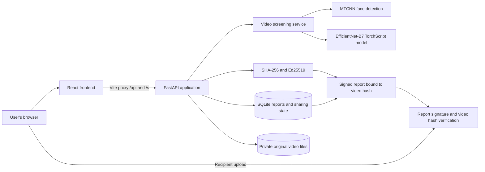

# FrameSeal

FrameSeal is a local video screening and verification app. Its FastAPI backend screens sampled faces for manipulation signals, signs a report bound to the exact uploaded video bytes, and supports private report history, eligible sharing, revocation, and recipient verification. The React frontend provides the browser interface.

An AI assessment is an estimate, not proof that a video is real or fake. A valid signature and matching hash establish report integrity and file association, not that the video depicts a genuine event. Scores are not calibrated probabilities, and detection performance has not been measured on a labeled evaluation dataset.

Analysis results show annotated previews of the exact sampled frames, including face boxes, per-face scores, and exclusion reasons. Optional AI-generated explanations summarize report metrics; they are not visual feature attribution. Preview images are returned to the browser and are not part of the signed report.

## Architecture



The frontend development server runs on port `5173` and proxies API and share requests to the backend on port `8000`.

## Run locally

Install the backend dependencies and the model assets once. Run these commands from `backend/` in PowerShell:

```powershell
uv venv
uv pip install --python .venv\Scripts\python.exe -r requirements.txt
.\.venv\Scripts\python.exe scripts\download_model.py
.\.venv\Scripts\python.exe scripts\setup_faces.py
```

The two scripts download the pinned detector checkpoint and MTCNN weights and verify their checksums. Ollama explanations are optional. To enable them, create a `.env` file in the repository root with your key:

```dotenv
OLLAMA_API_KEY=your-ollama-key
OLLAMA_MODEL=gemma4:31b
```

`OLLAMA_MODEL` is optional; it defaults to `gemma4:31b`. Restart FastAPI after changing `.env`. The backend sends only report metrics and assessment text to Ollama Cloud, never the video. `.env` is ignored by Git; keep the key out of frontend code and source control. A shell environment variable overrides the value in `.env`.

Start the backend from `backend/`:

```powershell
.\.venv\Scripts\python.exe -m uvicorn app.asgi:app --reload --host 127.0.0.1 --port 8000 --workers 1
```

In another terminal, install and start the frontend from `frontend/`:

```powershell
npm ci
npm run dev
```

Open <http://127.0.0.1:5173/>. Keep both servers running while using the app. To run the backend tests from `backend/`, use:

```powershell
.\.venv\Scripts\python.exe -m pytest -q
```

## Project layout

- `backend/app/` contains the API, video screening, signing, verification, sharing, and persistence code.
- `backend/scripts/` contains the checksum-verifying model asset setup scripts.
- `backend/docs/` contains [architecture](backend/docs/ARCHITECTURE.md), [security](backend/docs/SECURITY.md), and [evaluation](backend/docs/EVALUATION.md) notes.
- `frontend/` contains the React/Vite client.

No labeled dataset or measured detection-performance results are included. Audio detection, temporal analysis, and factual verification are outside the current scope.
